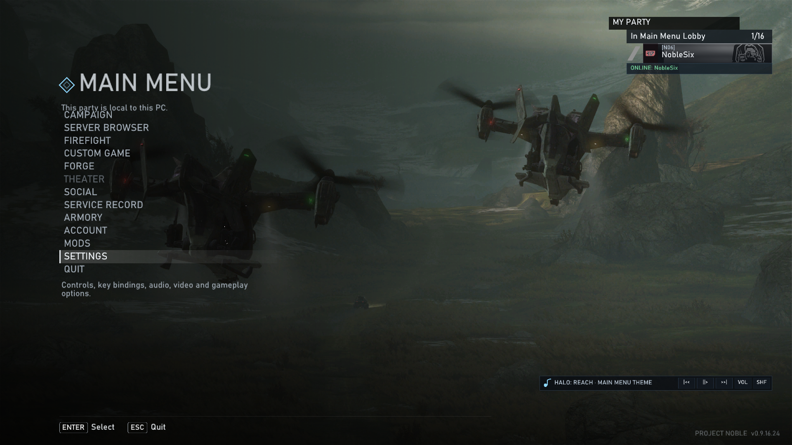
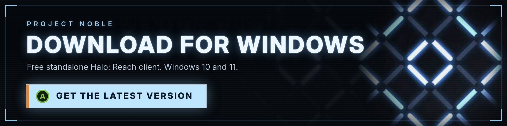
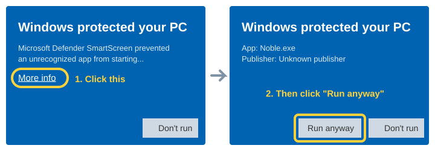
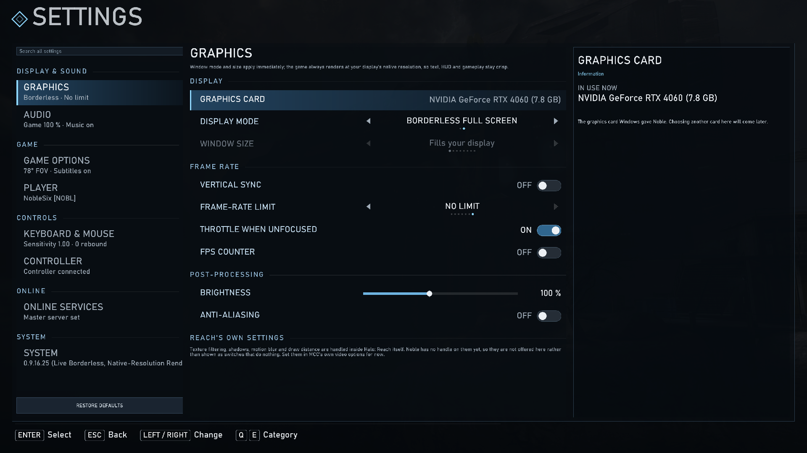
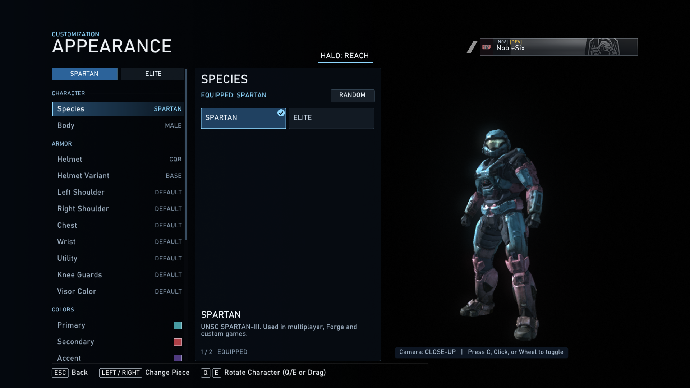
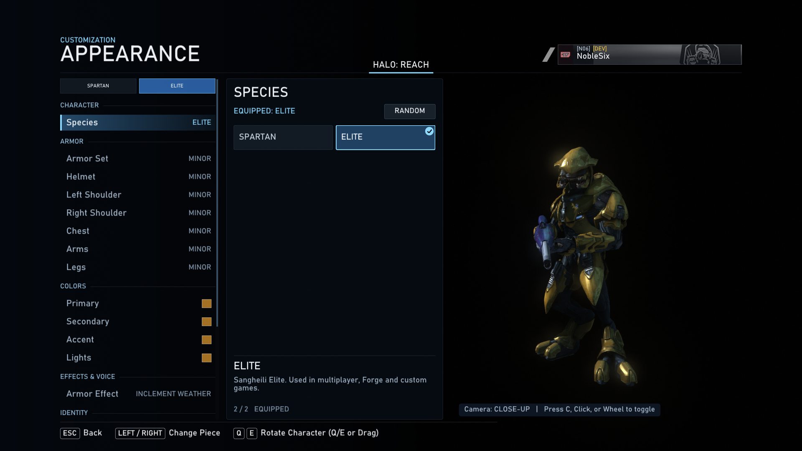
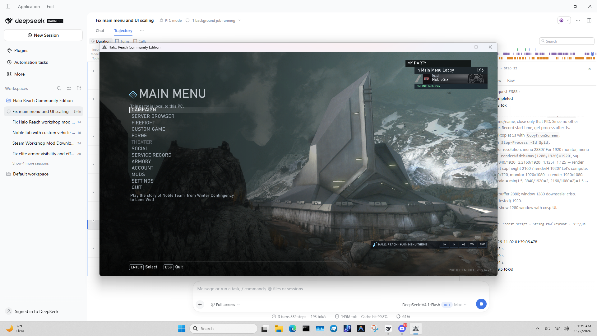

# Project Noble

**Halo: Reach Community Edition** — a standalone community client for Halo: Reach with expanded multiplayer, custom games, Forge and full Spartan/Elite customization.

## Download

**Click the banner above** (or **[this link](https://github.com/O7OF/Project-Noble-/releases/latest)**). On the page that opens, scroll to **Assets** and click `Project-Noble-vX.Y.Z-win64.zip` (the `.zip` file, not the `.sha256` or "Source code" ones).
Only download Project Noble from this page. Copies shared anywhere else could be tampered with.

## How to install (3 steps)

**1. Download the zip** from the release page (banner above).
Your browser saves it to your **Downloads** folder.

**2. Extract the whole folder somewhere you can write to.**
Right-click the zip, choose **Extract All...**, and pick a folder like `C:\Games\Project Noble` or `Documents\Project Noble`. Keep everything from the zip together.

**3. Open the folder and double-click `Noble.exe`** (or `play.bat`).
If a blue box says **"Windows protected your PC"**, click **More info**, then **Run anyway**. This appears because Project Noble is a free community project without a paid signing certificate. It only happens the first time.

  

Make sure **Steam** is running first. Noble checks that you own Halo: Reach, then opens the main menu.

## Features

### Multiplayer

- **Custom multiplayer for up to 128 players.**
- **Firefight for up to 16 players.**
- **Campaign co-op for up to 16 players.**
- **Forge for up to 128 players.**
- Custom Games, Slayer, objective modes, infection, race, invasion and community game types.
- LAN and online lobbies with a built-in **server browser**.
- Party and lobby roster, team selection, map and game-type voting.
- Matchmaking-style playlists and custom map/mod support.
- Voice chat, invite notifications and NAT/UPnP diagnostics.

### Customization

- Full **Spartan and Elite Armory** with live 3D previews.
- Helmets, helmet variants, shoulders, chest, wrist, utility, knees, visors and armor effects.
- Primary, secondary, accent and lights colors, plus custom color wheels.
- Emblems, emblem backgrounds, nameplates and service tags.
- Per-slot close-up cameras and full-body previews.

### Progression

- Reach's **50-rank career system**.
- Original **credit** earning and purchasing.
- Commendations, challenges and daily/weekly goals.
- Service record with stats, playtime and match history.
- Post-game results with credit payouts.

### Presentation & quality of life

- Crisp native-resolution rendering in windowed and borderless modes.
- **Switch windowed / borderless instantly** from Settings.
- Custom menu backgrounds — use your own images.
- Field of view, camera, brightness, FXAA, VSync and frame-rate options.
- Full controller support, button layouts, dead zones and vibration.
- Keyboard and mouse rebinding, sensitivity and smoothing.
- Menu music, game audio, subtitles and voice-chat controls.
- **In-app updates** — new builds appear in the main menu and install in place.

## Requirements

- Windows 10 or Windows 11, 64-bit
- Steam with **Halo: The Master Chief Collection** and the **Halo: Reach** DLC installed
- A Direct3D 11 capable graphics card

## Screenshots

| Settings | Armory — Spartan |
|---|---|
|  |  |

| Armory — Elite | Windowed |
|---|---|
|  |  |

## Updates

The main menu checks this release page. When a newer build is available, an **UPDATE AVAILABLE** panel appears under MY PARTY:

1. Press **DOWNLOAD**.
2. Press **RESTART & INSTALL**.

Your settings, career, appearance and mods are kept.

## Notes

- Halo and Halo: Reach are trademarks of Microsoft. This is a free community project.
- Release builds keep a private crash/error log only; normal play does not write gameplay or diagnostic details.
