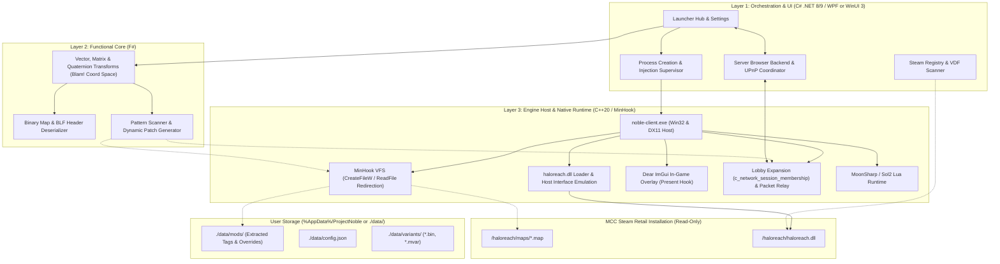

# Halo Reach Community Edition (Project Noble)
## Multi-Layered Architecture Specification & Engineering Plan

---

## 1. Executive Summary & Architectural Philosophy

**Halo Reach Community Edition** (working codename: **Project Noble**) is an open-source, non-destructive PC wrapper, custom client host, and dedicated server suite for **Halo: Reach**.

The project builds upon the architectural philosophy of **Project Reclaimer (Halo 3)** while introducing a modern, high-performance, multi-layered architecture:
1. **Zero Copyrighted Game Assets:** Ships no proprietary game assets (maps, sounds, meshes, textures, or code binaries).
2. **Non-Destructive Steam Integration:** Reads assets directly from the user's legally owned Steam installation of *Halo: The Master Chief Collection (MCC)* (`AppID 976730`). The user's retail MCC install is never modified.
3. **Multi-Layered Polyglot Stack:**
   - **C# (.NET 8/9 / WPF or WinUI 3):** UI orchestration, launcher hub, Steam library management, process lifecycle supervision, and high-level networking/master server coordination.
   - **F# (Functional Math & Memory Core):** Pure functional 3D coordinate transformations, binary parsing of `.map` and BLF tag headers, and robust memory pattern scanning/patch generation.
   - **C++20 (Native Engine Host & MinHook VFS):** Direct `haloreach.dll` bootstrapper, Win32/DirectX 11 runtime hosting, file I/O redirection hooks, Dear ImGui in-game overlay, and low-level Blam! engine detours.

---

## 2. Evidence Grounding: Findings from Omaha Symbol Databases

Analysis of the Omaha developer cache build symbols located in `tests/evidence/`:
- `reach_omaha_boot_and_engine_functions.csv` (1,772 boot, engine, and lifecycle functions)
- `reach_omaha_release_symbols.csv` (57,169 release symbols)
- `reach_omaha_debug_symbols.csv` (224,625 debug symbols)

provides the exact structural definitions, function signatures, and memory layouts required for each layer.

### 2.1 Engine Boot, Lifecycle & VFS Symbols (`reach_omaha_boot_and_engine_functions.csv`)
| Symbol / Function Signature | Source Object | Architectural Role |
| :--- | :--- | :--- |
| `cache_files_copy_map(char const *, enum e_cache_file_load_action)` | `cache_files_windows.obj` | VFS file streaming and map allocation hook |
| `levels_get_default_firefight_map_id()`, `levels_get_multiplayer_map_ids(...)` | `levels.obj`, `levels_dlc.obj` | Map validation, playlist indexing, and mission launching |
| `main_loop_body(class c_flags<...>, unsigned long *, __int64 *, unsigned long *)` | `main.obj` | Blam! engine core tick loop synchronization |
| `c_tag_resource_prediction_atom_generator` (Host Slot 32) | `cache_file_tag_resource_runtime.obj` | Resolves host crash at RVA `0x2744F2` by supplying atom buffers (size `0x88`, count `0xA0`) |
| `c_player_profile_interface::get_map_completed_at_difficulty_level(...)` | `c_player_profile.obj` | Profile, armor unlocks, and campaign completion state |

### 2.2 Multiplayer, Networking & Lobby Symbols (`reach_omaha_release_symbols.csv`)
| Symbol / Function Signature | Source Object | Architectural Role |
| :--- | :--- | :--- |
| `c_network_session_membership::set_slot_counts(long private_slots, long public_slots, bool)` | `network_session_membership.obj` | Primary hook target to expand lobby caps beyond 16 players (to 32/64) |
| `c_network_session_membership::add_peer(long, enum e_network_session_peer_state, ...)` | `network_session_membership.obj` | Managing peer connections in custom P2P / dedicated server topologies |
| `c_network_session_membership::find_or_add_player(...)` | `network_session_membership.obj` | Player registration and output user assignment |
| `c_network_session_membership::set_player_properties(...)` | `network_session_membership.obj` | Armor permutations, colors, service tags, and voice settings |
| `peer_properties_update_encode(...)`, `peer_properties_update_decode(...)` | `network_session_membership.obj` | Bitstream encoding for peer-to-peer session state replication |
| `network_life_cycle_get_target_session_for_join()` | `network_life_cycle.obj` | Intercepting connection handshakes for custom fast-DL pause/resume |

### 2.3 Mathematics, Vectors & Forge Sandbox Symbols (`reach_omaha_release_symbols.csv`)
| Symbol / Data Structure | Source Object | Architectural Role |
| :--- | :--- | :--- |
| `union real_point3d { float x, y, z; }`, `union real_vector3d` | `real_math.obj` | Coordinate representation mapped directly to F# records |
| `struct real_matrix4x3`, `struct real32_quaternion` | `real_math.obj` | Object spatial orientation & Havok rigid-body transformation |
| `quaternions_interpolate(...)`, `quaternion_normalize(...)` | `real_math.obj` | Precision interpolation for netcode prediction and camera rails |
| `c_sandbox_engine::rotate_object(long, long, float, float, float)` | `game_engine_sandbox.obj` | Forge rotation gizmo unlock (pitch, yaw, roll beyond snap limits) |
| `c_sandbox_engine::manipulate_object(long, long)` | `game_engine_sandbox.obj` | Forge grab, translation, and budget checks (`total-budget-exists`) |

---

## 3. High-Level Multi-Layered Architecture

---

## 4. Subsystem Breakdown by Technology

### 4.1 Core Application (C# .NET 8 / 9 — WPF / WinUI 3)
- **Primary Responsibility:** Desktop launcher lifecycle, application configuration, mod library indexing, process supervision, and high-level networking.
- **Key Modules:**
  - `GameDiscoveryService`: Locates MCC installation via Windows Registry (`HKLM\SOFTWARE\WOW6432Node\Microsoft\Windows\CurrentVersion\Uninstall\Steam App 976730` and `HKCU\Software\Valve\Steam\SteamPath`) and parses `steamapps/libraryfolders.vdf`.
  - `ProcessSupervisor`: Spawns either the native host (`noble-client.exe`) or target process in suspended mode (`CREATE_SUSPENDED`), injects early-stage hooks before anti-cheat or Blam! thread dispatch, and resumes the thread.
  - `ModManager`: Computes SHA-256 hashes of mod packages, queries Steam Workshop collections, unpacks archives, and generates mod priority load orders for the VFS.
  - `MasterServerClient`: Connects to community master servers via gRPC / SignalR / REST, fetching active lobbies, calculating ping, and reporting telemetry.

### 4.2 Math & Memory Core (F#)
- **Primary Responsibility:** Immutable, strongly typed mathematical operations, binary format decoding, and pattern synthesis.
- **Key Modules:**
  - `BlamMath.fs`: 
    - Pure functional vector math matching Blam! structures: `RealPoint3D`, `RealVector3D`, `RealMatrix4x3`, `Real32Quaternion`.
    - Coordinate space transformations: Converts between screen space, projective space (`s_rasterizer_projection`), and world coordinates for in-game overlay gizmos and Forge placement.
    - Quaternion slerp and normalization mirroring Bungie's `quaternions_interpolate` and `quaternion_normalize`.
  - `TagFormat.fs`:
    - Binary parsing for `.map` cache headers (`s_cache_file_header`), index tables, and tag group descriptors (`s_cache_file_tag_group`).
    - Decodes game variants (`.bin` / `c_game_variant`) and map variants (`.mvar` / `c_map_variant`).
  - `SignatureScanner.fs`:
    - Compiles IDA-style byte signatures into fast bitmask scanning kernels.
    - Generates dynamic memory patches for Blam! functions based on the CSV symbol database offsets.

### 4.3 Native Injector, VFS & Engine Host (C++20 / MinHook / DirectX 11)
- **Primary Responsibility:** Low-overhead execution inside the game's address space, Direct3D 11 rendering, API detours, and raw engine hosting.
- **Key Modules:**
  - `noble::Loader`: Loads `haloreach.dll` into process memory using `LoadLibraryExW` and binds exported interfaces (`CreateGameEngine`, `CreateDataAccess`, `SetLibrarySettings`).
  - `noble::VFS`: Detours `CreateFileW`, `ReadFile`, `GetFileAttributesExW`. Maps requested paths (`maps\forge_halo.map`, tag resources) against active mod directories in `./data/mods/`, falling back transparently to Steam's read-only install.
  - `noble::D3D11Renderer` & `noble::UIManager`: Hooks `IDXGISwapChain::Present` to render Dear ImGui menu screens (Missions, Server Browser, Armor Locker, Forge Gizmos).
  - `noble::LobbyPatches`: Intercepts `c_network_session_membership::set_slot_counts` and expands player array limits from 16 to 32/64.
  - `noble::ScriptRuntime`: Embeds Lua (MoonSharp or Sol2) for hot-reloadable game mode scripting and UI events.

---

## 5. Five-Phase Implementation Roadmap

### Phase 1: Architecture & Tech Stack Setup
- **Goal:** Establish multi-language interop foundation and VFS redirection framework.
- **Deliverables:**
  - Solution structure containing:
    - `/src/launcher/` (C# .NET 8 / WPF launcher frontend)
    - `/src/core-math/` (F# functional math and binary parser library)
    - `/src/host/`, `/src/hooks/`, `/src/vfs/`, `/src/network/` (C++20 native host & MinHook DLLs)
  - Native-to-managed C ABI bridge (P/Invoke exports for launcher-to-host commands).
  - MinHook integration intercepting Win32 File APIs (`CreateFileW`, `ReadFile`).
  - Initial VFS redirection mapping `./data/mods/` overrides to base MCC assets.

### Phase 2: Game Discovery & Process Spawning
- **Goal:** Robust path resolution and controlled process execution.
- **Deliverables:**
  - Multi-drive Steam library parser (`libraryfolders.vdf`) in C#.
  - Steam ownership verification (`SteamAPI_Init` / AppID `976730`).
  - Process launcher supporting `CREATE_SUSPENDED` and custom launch arguments (`-windowed`, `-novsync`, `-modpath`).
  - Early-stage DLL injection before main thread resume.

### Phase 3: DLL Injection & Mod Support Pipeline
- **Goal:** In-engine execution, custom UI overlay, and scripting.
- **Deliverables:**
  - Direct `haloreach.dll` bootstrapper in C++ (`Loader`, `ReachHost`, `BlamEngine`).
  - Host Slot 32 resource pool allocator fix (resolving crash at RVA `0x2744F2` using prediction atom buffers from `reach_omaha_boot_and_engine_functions.csv`).
  - Dear ImGui DirectX 11 `Present` hook overlay.
  - Embedded Lua scripting runtime for custom triggers and UI widgets.

### Phase 4: Custom Multiplayer & Networking Layer
- **Goal:** Bypassing official matchmaking with custom lobbies and extended player counts.
- **Deliverables:**
  - Standalone server browser with TCP/UDP ping probes and master server registration.
  - UPnP automatic port-forwarding for peer-to-peer and dedicated hosts.
  - Blam! lobby expansion patches:
    - Detouring `c_network_session_membership::set_slot_counts` to support up to 64 slots.
    - Expanding `network-active-roster` buffer allocation and peer bitmasks.
  - Netcode packet relay hooks intercepting handshake messages (`membership-update`, `peer-properties`).
  - Custom map auto-sync (Fast-DL) pausing `network_life_cycle_get_target_session_for_join` while downloading `.map` / `.mvar` packages over HTTP.

### Phase 5: Build, Test & Iteration Pipeline
- **Goal:** Packaging, mod distribution, diagnostic logging, and test harness.
- **Deliverables:**
  - Automated mod packaging CLI bundling maps, tags, and manifests into compressed archives.
  - Structured logging across C# (Serilog), F#, and C++ (spdlog).
  - Automated crash minidump generation (`MiniDumpWriteDump`) with symbol correlation against the Omaha CSV symbol databases.
  - CI build matrix building C# launcher, F# core, and C++ native host binaries.

---

## 6. Implementation Recommendation

### Priority Assessment
The repository already contains a solid, functioning C++20 native host foundation (`src/host`, `src/hooks`, `src/vfs`, `src/engine`, `src/ui`, `src/network`). 

To realize the complete multi-layered architecture, the recommended next step is:
1. **Build the C# Launcher Foundation & Process Spawning Pipeline (Phase 1 / 2):**
   - Provide the clean, modern desktop GUI for configuration, mod management, and launch parameter selection.
   - Orchestrate launching `noble-client.exe` or injecting the native payload with custom parameters.
2. **Build the F# Functional Core (Phase 1 / 2):**
   - Implement `BlamMath.fs` (using the `real_point3d` / `real_matrix4x3` / `quaternion` definitions from the Omaha symbols).
   - Implement `TagParser.fs` and `SignatureScanner.fs` to parse `.map` headers and verify runtime memory offsets.
3. **Refine C++ Hooks (Phase 3 / 4):**
   - Connect the C# launcher's network coordinator to the native `c_network_session_membership` lobby expansion hooks.
