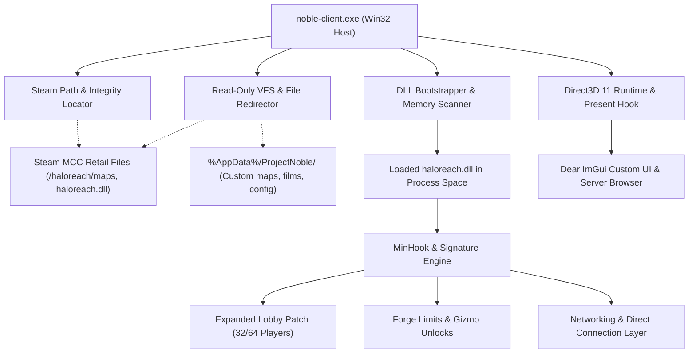

# Halo Reach Community Edition (Project Noble)
## Architectural Plan & Technical Specification

---

## 1. Executive Summary & Objective

**Halo Reach Community Edition** (working codename: **Project Noble**) is an open-source, standalone, non-destructive PC wrapper, custom client host, and dedicated server launcher for **Halo: Reach**.

This project adheres strictly to the architectural philosophy of **Project Reclaimer (Halo 3)**:
- **Zero Copyrighted Game Assets:** Ships no proprietary game assets (maps, sounds, meshes, textures, or code binaries).
- **Non-Destructive Steam Integration:** Reads directly from the user's local Steam installation of *Halo: The Master Chief Collection (MCC)* (`AppID 976730`). The user's retail MCC install is never modified.
- **Bypassing the UE4 Frontend:** Completely circumvents `MCC-Win64-Shipping.exe` and Easy Anti-Cheat (EAC) by hosting `haloreach.dll` directly inside a custom Win32/DirectX 11 runtime host with a Dear ImGui overlay, custom server browser, and modern networking layer.

---

## 2. Technical Findings from Binary Analysis (`haloreach.dll`)

Using REA (Reverse Engineer Anything) static inspection on the retail `haloreach.dll` located at:
`C:\Program Files (x86)\Steam\steamapps\common\Halo The Master Chief Collection\haloreach\haloreach.dll`

### 2.1 Export Table Structure
| Ordinal | Function Name | RVA | Notes |
|:---:|:---|:---:|:---|
| 1 | `CreateDataAccess` | `0x180010558` | Factory for tag/cache/map reader interfaces (`c_data_access`) |
| 2 | `CreateGameEngine` | `0x180010468` | Primary Blam! game engine factory (`c_game_engine`) |
| 3 | `SetLibrarySettings` | `0x1800103f4` | Pre-init configuration (logging, paths, telemetry overrides) |

*Note: The internal DLL name specified in the PE header is `halo3_dll_cache_release_UUI_x64.dll`, confirming that MCC's Reach port shares the exact unified host interface architecture pioneered by Halo 3.*

### 2.2 Comparison with Project Reclaimer (`project-reclaimer-client-v0.9.18.exe`)
Inspection of Project Reclaimer's client executable reveals the exact operational pattern needed for Reach:
1. **Window & SwapChain Creation:** A lightweight Win32 window host creates a standard Direct3D 11 device and swap chain (`dxgi.dll`, `d3d11.dll`).
2. **Host-to-Engine VTable Injection:** Passes a host interface implementation to `CreateGameEngine`, forwarding the `HWND`, `ID3D11Device`, `IDXGISwapChain`, audio endpoints (`mmdevapi.dll`), and raw input queues (`user32.dll` RawInput).
3. **Detour & Patching Subsystem:** Uses memory hooks (MinHook) and signature scanning to intercept Blam! engine routines for file I/O redirection, lobby sizes, Forge limits, and input handling.

---

## 3. Core Subsystems & Architecture

### 3.1 Non-Destructive Steam Validation & VFS
- **Steam Discovery:** Queries Windows Registry (`HKLM\SOFTWARE\WOW6432Node\Microsoft\Windows\CurrentVersion\Uninstall\Steam App 976730` and `HKCU\Software\Valve\Steam\SteamPath`) and parses `steamapps/libraryfolders.vdf` to discover multi-drive installations.
- **Verification:** Verifies presence of `haloreach.dll`, `maps/`, and `fmod/`.
- **Virtual File System (VFS):**
  - Hooks `CreateFileW`, `ReadFile`, and directory enumeration.
  - Base MCC maps (`.map`), audio banks, and paks are read transparently from Steam.
  - Game saves, films, screenshots, custom game variants (`.bin`), and map variants (`.mvar`) are routed to `%AppData%/ProjectNoble/` or a local `./data/` folder.

### 3.2 Win32 Host & Engine Bootstrapper
- **Process Host:** Native 64-bit C++20 application (`noble-client.exe`).
- **Graphics Pipeline:** Initializes an `ID3D11Device`, `ID3D11DeviceContext`, and `IDXGISwapChain`.
- **Bootstrapping:** Loads `haloreach.dll` via `LoadLibraryExW`, executes `SetLibrarySettings`, instantiates the engine via `CreateGameEngine`, and supplies the host environment struct.

### 3.3 Custom In-Game UI & Server Browser
- **Overlay:** Injected into `IDXGISwapChain::Present` to render Dear ImGui overlay menus.
- **Server Browser:** Queries master server or direct IP/port; displays ping, player count, current map, variant, and game mode.
- **Armor & Customization:** Direct memory structure injection for Spartan/Elite armor permutations, primary/secondary/detail colors, emblems, and service tags without needing MCC's Unreal Engine frontend.

### 3.4 Networking & Headless Dedicated Server
- **Lobby Limit Expansion:** Replaces Blam! engine 16-player lobby caps with expanded 32-to-64 player caps for multiplayer, and raises campaign/firefight co-op limits.
- **Headless Server (`noble-dedicated.exe`):** Strips render pipeline and executes game loop in console mode, controllable via JSON/TOML configurations and an authenticated RCON socket.
- **On-Join Fast-DL:** Auto-downloads custom `.map` or Forge `.mvar` packages from host HTTP endpoints or Steam Workshop cache before finalizing connection handshakes.

---

## 4. Implementation Phasing

### Phase 1: Discovery & Bootstrapper (Immediate Target)
1. **Build System:** Configure `CMakeLists.txt` using C++20, targeting MSVC x64 with dependencies:
   - MinHook (hooking library)
   - spdlog (logging)
   - nlohmann_json (configuration)
2. **Steam MCC Discovery:** Implement `SteamLocator` to discover install paths and verify files.
3. **Win32 & DX11 Host:** Implement lightweight window management and Direct3D 11 initialization.
4. **Core `Loader`:**
   - Load `haloreach.dll` into process space.
   - Enumerate and bind `CreateGameEngine`, `CreateDataAccess`, and `SetLibrarySettings`.
   - Setup byte pattern signature scanner (`SigScanner`) and initialize MinHook.

### Phase 2: Engine Interface Emulation & VFS (Next Phase)
- Implement host vtable expected by `CreateGameEngine`.
- Implement `VFS` hook layer intercepting Win32 File APIs to redirect paths cleanly.

### Phase 3: DX11 Overlay & Custom UI
- Dear ImGui integration in `Present` hook.
- Server browser UI, settings menu, and armor permutation editor.

### Phase 4: Networking, Dedicated Servers & Fast-DL
- Headless dedicated server launcher (`noble-dedicated.exe`).
- 32/64 player lobby memory patches.
- Fast-DL HTTP client and RCON administration console.

### Phase 5: Forge & Engine Tweaks
- Unlocking Forge budget, object counts, and rotation axes in memory.
